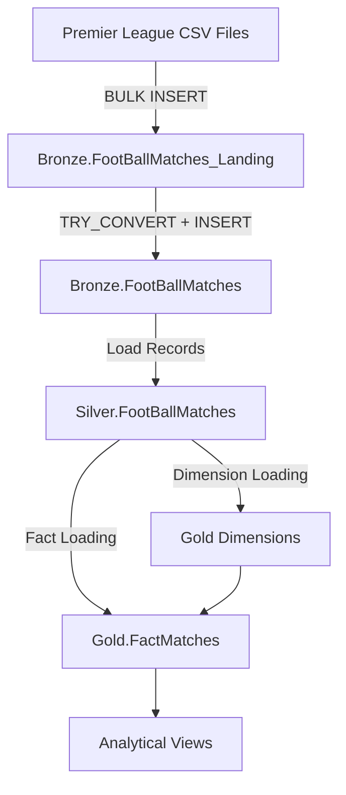
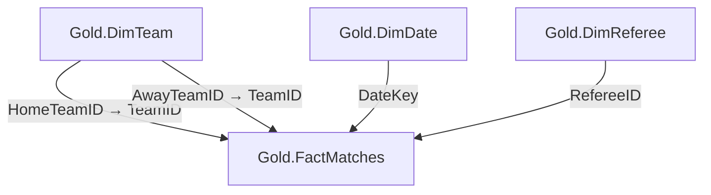

# ⚽ Football Data Warehouse

**SQL Server | T-SQL | Medallion Architecture | Dimensional Modeling**

A personal Data Engineering portfolio project that transforms English Premier League match data into a structured SQL Server Data Warehouse using **Bronze, Silver, and Gold layers**.

The project processes, football matches across five Premier League seasons (2021/22–2025/26)** and demonstrates batch ingestion, data validation, data quality management, dimensional modeling, and SQL-based analytics.

---

## 1. Project Overview

Football match datasets contain valuable information about team performance, match results, referees, and match statistics.

This project organizes Premier League match data into a relational Data Warehouse designed to support consistent analytical queries.

### Objectives

- Ingest seasonal CSV files into SQL Server.
- Implement Bronze, Silver, and Gold data layers.
- Validate data types, match results, and statistical consistency.
- Identify, document, and correct data quality issues.
- Preserve original source values in Bronze.
- Design a Star Schema with fact and dimension tables.
- Build analytical SQL views for team and referee performance.
- Validate record counts and dimensional mappings across warehouse layers.

## 2. Technology Stack

| Technology | Usage |
|---|---|
| Microsoft SQL Server | Data Warehouse |
| SQL Server Management Studio (SSMS) | SQL development, execution, and validation |
| T-SQL | Ingestion, transformations, validation, and analytics |
| CSV | Source data format |
| Git & GitHub | Version control and documentation |

## 3. Data Source

**Dataset:** English Premier League

**Dataset repository:** [DataHub — English Premier League](https://datahub.io/football/english-premier-league)

**Original data provider:** [Football-Data.co.uk](https://www.football-data.co.uk/) (credited as the source on the DataHub dataset page)

**License listed by DataHub:** [Open Data Commons Public Domain Dedication and License (ODC-PDDL-1.0)](https://opendatacommons.org/licenses/pddl/1-0/)

DataHub states that the dataset is intended for educational and research purposes and advises reviewing Football-Data.co.uk's terms before any wider use. This project is an educational portfolio project.

### Dataset Coverage

| Season | Matches |
|---|---:|
| 2021/22 | 380 |
| 2022/23 | 380 |
| 2023/24 | 380 |
| 2024/25 | 380 |
| 2025/26 | 380 |
| **Total** | **1,900** |

### Source Files

```text
season-2122.csv
season-2223.csv
season-2324.csv
season-2425.csv
season-2526.csv
```

Each file has the same 22 columns: match date, teams, full-time and half-time results, referee, and match statistics (shots, shots on target, fouls, corners, and cards).

The CSV files are not included in this repository. Download them from the DataHub dataset page above.

## 4. Data Architecture

The project follows a **Medallion Architecture**, separating raw data ingestion, quality management, and analytical modeling.



### Bronze Layer — Data Ingestion

The Bronze Layer handles the ingestion and initial storage of football match records.

**Tables:**

- `Bronze.FootBallMatches_Landing`
- `Bronze.FootBallMatches`

The Landing table stores CSV fields as text, allowing the imported data to be inspected before conversion.

The main Bronze table stores match records using SQL data types such as `DATE`, `INT`, and `NVARCHAR`.

#### Processing Workflow

1. Import seasonal CSV data using `BULK INSERT`.
2. Inspect imported rows and column structures.
3. Validate date and numeric values using `TRY_CONVERT`.
4. Convert source values into their corresponding SQL data types.
5. Insert records into `Bronze.FootBallMatches`.
6. Assign the corresponding season.
7. Clear and reuse the Landing table for the next season.

The Bronze Layer preserves original source values, including inconsistencies identified during subsequent validation.

### Silver Layer — Data Cleaning and Quality Management

The Silver Layer stores match records prepared for analytical use.

**Tables:**

- `Silver.FootBallMatches`
- `Silver.DataQualityIssues`

Records are loaded from Bronze into Silver with an additional `DataQualityStatus` field.

#### Data Quality Status

| Status | Description |
|---|---|
| `Valid` | Record loaded without a documented correction |
| `Corrected` | Record with a documented correction |
| `NeedsReview` | Supported status for records requiring investigation |

The `DataQualityIssues` table records information about identified data quality problems, including the affected match, original value, corrected value, issue description, correction source, and resolution status.

### Data Quality Issue #001 — Newcastle vs West Ham

During data validation, an inconsistency was identified in the Premier League match between Newcastle United and West Ham United.

**Match:** Newcastle United 2–4 West Ham United  
**Date:** August 15, 2021  
**Season:** 2021/22

| Statistic | Original Value | Corrected Value |
|---|---:|---:|
| Away Shots (AS) | 8 | 18 |
| Away Shots on Target (AST) | 9 | 9 |

**Validation rule:**

```text
Shots on Target <= Total Shots
```

The original record violated this rule because West Ham had 9 shots on target but only 8 recorded total shots.

Two independent football statistics sites report **18 total shots and 9 shots on target** for West Ham in this match, consistent with the recorded shots on target and with Newcastle's 17 total shots already in the source data.

**Verification Sources:**

- [Football Web Pages — Newcastle vs West Ham, August 15, 2021](https://www.footballwebpages.co.uk/match/2021-2022/premier-league/newcastle-united/west-ham-united/375814)
- [Legz — Newcastle vs West Ham, 2021/22](https://www.legz.com.au/epl/fixtures/2021-22/round-1/1917/newcastle-united-v-west-ham-united)

The correction was applied to `Silver.FootBallMatches`, changing the away shots value from 8 to 18.

The affected record was marked as `Corrected`, and a corresponding issue was stored in `Silver.DataQualityIssues` with the status `Resolved`.

The original Bronze record was preserved for traceability.

### Gold Layer — Dimensional Modeling

The Gold Layer provides an analytical **Star Schema** containing one fact table and three dimension tables.

#### Fact Table

`Gold.FactMatches`

Each row represents one football match.

The table contains match-related measures and references, including:

- Match date
- Home and away teams
- Referee
- Season
- Full-time and half-time scores
- Match results
- Shots and shots on target
- Fouls and corners
- Yellow and red cards

#### Dimension Tables

| Dimension | Description |
|---|---|
| `Gold.DimTeam` | Football team information |
| `Gold.DimDate` | Match dates and calendar attributes |
| `Gold.DimReferee` | Referee information and match totals |

#### Star Schema



`Gold.DimTeam` is a role-playing dimension used for both home and away teams.

The fact table uses primary and foreign key constraints to maintain relationships with the dimensions.

A `CK_DifferentTeams` constraint prevents a match from referencing the same team as both home and away.

## 5. Data Quality and Validation

Data quality checks were implemented across the three warehouse layers.

### Bronze Checks

- Invalid date and numeric values
- Duplicate match records
- Negative goal values
- Inconsistent full-time results
- Inconsistent half-time results
- Shots on target exceeding total shots
- Missing team, referee, and match statistics

### Silver Checks

- Bronze and Silver record counts
- Match counts grouped by quality status
- Corrected records
- Resolved data quality issues
- Verification of the documented correction

### Gold Checks

- Missing home team mappings
- Missing away team mappings
- Missing date mappings
- Missing referee mappings
- Duplicate fact records
- NULL or invalid keys
- Silver-to-Gold comparisons and reconciliation queries

## 6. Validation Results

The following results were obtained by executing SQL queries against the `FootBallDH` database in SQL Server Management Studio.

### Record Counts

| Layer | Total Records |
|---|---:|
| Bronze — `FootBallMatches` | 1,900 |
| Silver — `FootBallMatches` | 1,900 |
| Gold — `FactMatches` | 1,900 |

### Silver Quality Status

| Status | Records |
|---|---:|
| Valid | 1,899 |
| Corrected | 1 |
| **Total** | **1,900** |

### Data Quality Issue Tracking

| Issue Status | Count |
|---|---:|
| Resolved | 1 |

### Gold Integrity Checks

| Validation Check | Result |
|---|---:|
| Missing Home Team Mappings | 0 |
| Missing Away Team Mappings | 0 |
| Missing Date Mappings | 0 |
| Missing Referee Mappings | 0 |
| Duplicate Fact Groups | 0 |
| Silver Match Count | 1,900 |
| Gold Match Count | 1,900 |

The results confirm matching record counts across the three layers, no missing dimension mappings in the executed checks, and no duplicate fact groups.

Additional Silver-to-Gold reconciliation queries are included in the SQL scripts.

## 7. Analytical Views

Three SQL views support football analytics.

| View | Purpose |
|---|---|
| `Gold.vw_LeagueStandings` | Calculate team standings by season |
| `Gold.vw_HomeAwayPerformance` | Compare home and away team performance |
| `Gold.vw_RefereeStats` | Analyze match statistics associated with referees |

### League Standings

`Gold.vw_LeagueStandings` calculates:

- Matches played
- Wins, draws, and losses
- Goals for and against
- Goal difference
- Points
- League position

### Home vs Away Performance

`Gold.vw_HomeAwayPerformance` compares team performance based on match venue.

### Referee Statistics

`Gold.vw_RefereeStats` provides match counts and recorded disciplinary and foul statistics by referee.

## 8. Example Analytics — Premier League 2023/24

The following query retrieves the top five teams from the Gold analytical view.

```sql
SELECT TOP 5 *
FROM Gold.vw_LeagueStandings
WHERE Season = '2023/24'
ORDER BY LeaguePosition;
```

### Query Results

| Position | Team | Played | Wins | Draws | Losses | GF | GA | GD | Points |
|---:|---|---:|---:|---:|---:|---:|---:|---:|---:|
| 1 | Man City | 38 | 28 | 7 | 3 | 96 | 34 | +62 | 91 |
| 2 | Arsenal | 38 | 28 | 5 | 5 | 91 | 29 | +62 | 89 |
| 3 | Liverpool | 38 | 24 | 10 | 4 | 86 | 41 | +45 | 82 |
| 4 | Aston Villa | 38 | 20 | 8 | 10 | 76 | 61 | +15 | 68 |
| 5 | Tottenham | 38 | 20 | 6 | 12 | 74 | 61 | +13 | 66 |

*Results captured from SQL Server using the project's `Gold.vw_LeagueStandings` view. The same table was independently recomputed from the source CSV file and matched.*

## 9. Repository Structure

```text
Football-Data-Warehouse/
│
├── README.md
│
└── sql/
    │
    ├── 00_database_setup.sql
    │
    ├── Bronze/
    │   ├── 01_create_bronze_tables.sql
    │   ├── 02_load_bronze_data.sql
    │   └── 03_bronze_quality_checks.sql
    │
    ├── Silver/
    │   ├── 01_create_silver_tables.sql
    │   ├── transform_to_silver.sql
    │   └── silver_quality_checks.sql
    │
    └── Gold/
        ├── 01_create_gold_tables.sql
        ├── 02_load_gold_dimensions.sql
        ├── 03_load_fact_matches.sql
        ├── 04_gold_quality_checks.sql
        ├── 05_create_gold_views.sql
        └── 06_gold_analytical_queries.sql
```

## 10. How to Run

The project uses SQL scripts executed manually through SQL Server Management Studio.

### Prerequisites

- Microsoft SQL Server
- SQL Server Management Studio
- Five seasonal Premier League CSV files (see [Data Source](#3-data-source))

### Execution Order

| Step | Script | Purpose |
|---|---|---|
| 1 | `00_database_setup.sql` | Create database and schemas |
| 2 | `Bronze/01_create_bronze_tables.sql` | Create Bronze tables |
| 3 | `Bronze/02_load_bronze_data.sql` | Load five seasons |
| 4 | `Bronze/03_bronze_quality_checks.sql` | Inspect Bronze data |
| 5 | `Silver/01_create_silver_tables.sql` | Create and populate Silver tables; log issue |
| 6 | `Silver/transform_to_silver.sql` | Apply documented correction |
| 7 | `Silver/silver_quality_checks.sql` | Inspect Silver quality status |
| 8 | `Gold/01_create_gold_tables.sql` | Create Gold dimensions and fact table |
| 9 | `Gold/02_load_gold_dimensions.sql` | Populate dimensions |
| 10 | `Gold/03_load_fact_matches.sql` | Populate fact table |
| 11 | `Gold/04_gold_quality_checks.sql` | Validate Gold records |
| 12 | `Gold/05_create_gold_views.sql` | Create analytical views |
| 13 | `Gold/06_gold_analytical_queries.sql` | Execute analytical queries |

### Execution Notes

- Configure the CSV paths in the Bronze ingestion script before running it.
- The scripts include both setup and data loading operations, and are run manually in the order above.
- The Silver creation script includes table creation, record loading, and issue logging.
- Landing-table validation queries are most meaningful immediately after importing their corresponding season.
- The workflow was run end to end on the `FootBallDH` database and re-tested on a clean database following the order above.
- To reproduce the workflow, run the scripts in the order above against a fresh test database.

## 11. Skills Demonstrated

- SQL Server database development
- Batch ingestion using `BULK INSERT`
- SQL data type conversion
- Data quality validation
- Data quality issue tracking
- Medallion Architecture
- Dimensional modeling
- Star Schema design
- Fact and dimension table relationships
- Primary and foreign key constraints
- Common Table Expressions (CTEs)
- Analytical SQL views
- Cross-layer record validation
- Technical documentation

## 12. Future Improvements

Planned next steps:

- Orchestrating ingestion and transformation workflows with Apache Airflow.
- Implementing incremental data loading.
- Adding automated data quality tests.
- Developing a Power BI dashboard.
- Expanding the warehouse with additional football datasets.

---

**Project Type:** Personal Data Engineering Portfolio Project  
**Architecture:** Bronze → Silver → Gold  
**Database:** Microsoft SQL Server  
**Dataset:** English Premier League, 2021/22–2025/26
